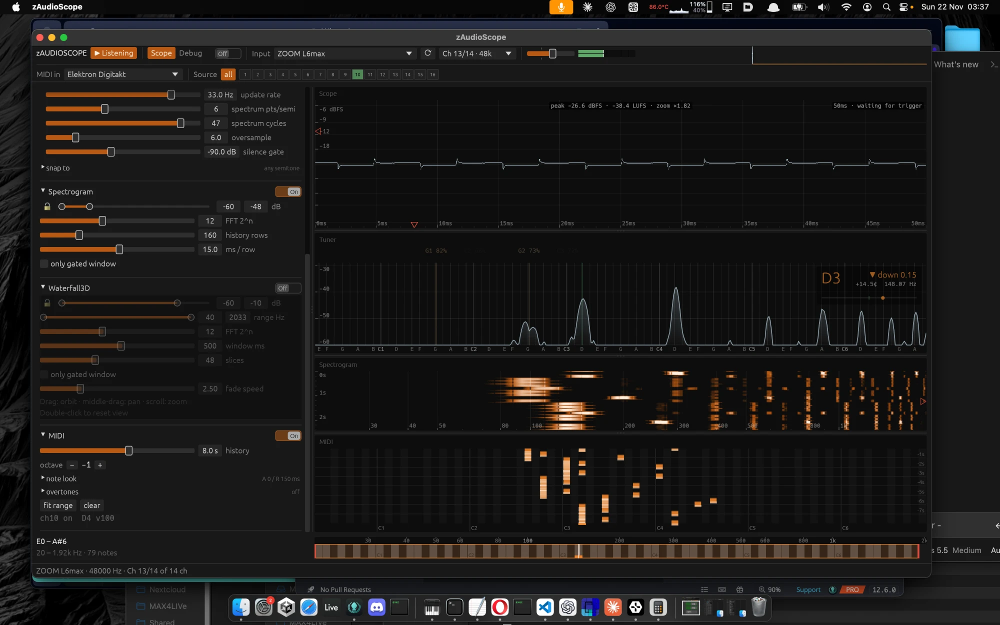

# zAudioScope

A realtime audio utility scope for analysing live input, written in Rust with [egui](https://github.com/emilk/egui) and [cpal](https://github.com/RustAudio/cpal).



## What it is (or will be, soon)

zAudioScope is a set of stacked analyser modules fed from an audio input device, with a MIDI view alongside:

- **Scope**: a trigger-based waveform view. It locks onto a peak such as a kick drum and shows a selectable window after it (for example, the 20–40 ms after a kick, to isolate the bass note that follows). A free mode analyses everything. Shows peak level in dBFS and LUFS.
- **Tuner**: a spectrum with note labels, a pitch readout (note, cents offset, frequency) and candidate notes with confidence values.
- **Spectrogram**: a scrolling time–frequency view with configurable FFT size, history and row timing.
- **Waterfall3D**: a 3D waterfall of the spectrum over time, with orbit, pan and zoom.
- **MIDI**: a piano-roll style note history, driven by a connected MIDI input and filterable by channel and source.

The top bar selects the audio input and MIDI device and toggles modules on and off. A status bar shows the active device, sample rate and channel count. Parameters are saved with the app state, so the layout survives restarts.

The goal is a tool for tuning bass and syncing outboard samples: play a note on repeat and see its pitch and harmonics, with the pitch snapped to the nearest semitone.

## Downloads

Prebuilt binaries are on the [Releases](https://github.com/zambari/zAudioScope/releases) page: a macOS (Apple silicon) zip and a Windows x64 zip built with ASIO support.

The builds are not signed, so the OS warns the first time you open them:

- **macOS**: the first launch is blocked ("Apple could not verify…"). Open **System Settings → Privacy & Security**, scroll to the message about `zaudioscope` and click **Open Anyway**, then launch it again. Or clear the download quarantine flag from Terminal:

  ```bash
  xattr -d com.apple.quarantine ./zaudioscope
  ```

  macOS then asks for microphone access, which the scope needs to read your audio input.
- **Windows**: SmartScreen may show "Windows protected your PC". Click **More info → Run anyway**.

## Building and running

Requires a recent stable Rust toolchain (edition 2024).

```bash
cargo run --release
```

Debug builds are also usable: dependencies and the DSP code are compiled with optimisation enabled in `Cargo.toml`.

## Platform

Developed and tested on macOS. Windows release builds are made by GitHub Actions (WASAPI, DirectSound and ASIO); other platforms are untested.

## Licence

MIT. See [LICENSE](LICENSE).
